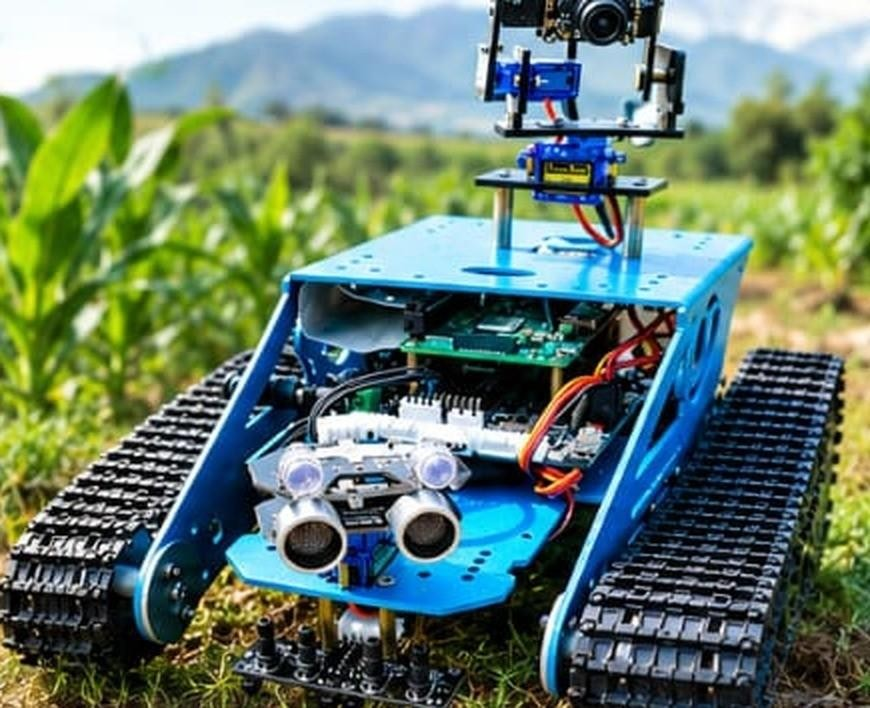
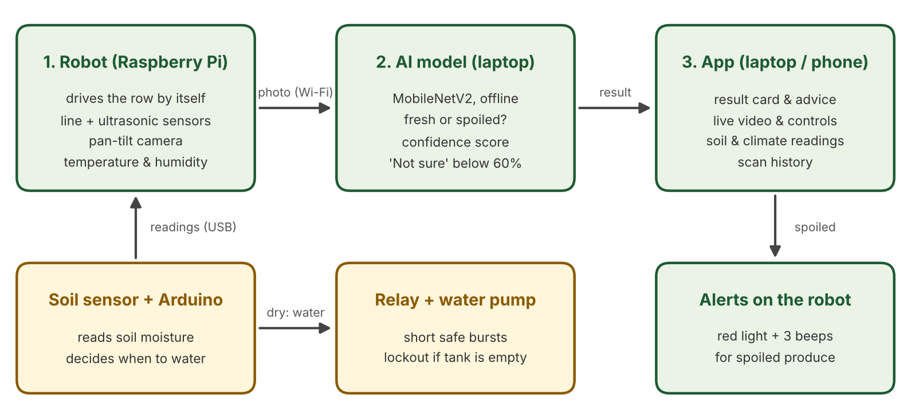

# AgriScout — AI farm-scouting robot for smallholder farmers

**An affordable, offline AI robot that helps Zambian farmers lose less produce, earn more and use less water.**

**1st Prize — UNILUS Tech Expo & Innovation Challenge 2026** (School of Technology & Engineering, University of Lusaka)

<p align="center">
  
</p>

> **Demo video:** [add your YouTube or Google Drive link here]

---

## Why AgriScout?

Agriculture supports the livelihoods of more than 70% of Zambians, yet most smallholder farmers still:

- **check crops on foot**, row by row, and easily miss early warning signs;
- **find spoiled tomatoes and peppers only at the market**, when the buyer marks the price down;
- **water by guesswork**, wasting water, fuel and labour, or losing crops in dry spells like the 2024 drought.

Imported precision-farming tools are expensive and usually need internet. AgriScout is built from low-cost parts and works **completely offline**.

## What it does

| Feature | Description |
|---|---|
| **Row scouting** | Follows a crop row by itself using line sensors; stops for obstacles using an ultrasonic sensor |
| **Live video & control** | Drive the robot and move the pan-tilt camera from a laptop app or a phone browser |
| **AI produce check** | Classifies produce as fresh or spoiled tomato / pepper (or no produce) and recommends **Keep** or **Remove** |
| **Honest confidence** | Shows how sure it is, and says **"Not sure"** below 60% confidence instead of guessing |
| **Alerts on the robot** | Red light and three beeps when spoiled produce is found |
| **Climate sensing** | Temperature and humidity (DHT11) |
| **Soil moisture & auto-watering** | An Arduino reads soil moisture and runs a pump in short, safe bursts only when the soil is dry |
| **Offline** | Robot, laptop and phone talk over local Wi-Fi — no internet or mobile data needed |

## How it works

<p align="center">
  
</p>

1. **Scout** — the robot drives along the crop row.
2. **Scan** — the camera photographs the produce; sensors read soil moisture, temperature and humidity.
3. **Diagnose** — a MobileNetV2 image model (trained by our team) classifies the photo and reports its confidence.
4. **Act** — the app shows the result and advice, the robot signals spoiled produce, and the Arduino waters dry soil.

## Results

| | |
|---|---|
| **Model** | MobileNetV2 (transfer learning, PyTorch), exported to ONNX for fast offline inference |
| **Classes** | background (no produce), pepper fresh, pepper spoiled, tomato fresh, tomato spoiled |
| **Dataset** | ~9,000 photos collected and labelled by our team |
| **Accuracy** | **98.9%** on a held-out test set of 522 photos the model never saw during training |
| **Iterations** | Six model versions trained and compared; weak classes found with confusion matrices and fixed with targeted new photos |

See [docs/RESULTS.md](docs/RESULTS.md) for details.

**Limitations (honestly stated):** all testing so far has been indoors with tomatoes and peppers under a lamp and backdrop. The robot has not yet been trialled on a working farm, and it is not yet weatherproof. A field pilot is our next step.

## Hardware

| Part | Purpose |
|---|---|
| Yahboom G1 tracked tank chassis with BST-4WD expansion board | Movement, line sensors, ultrasonic sensor, LEDs, buzzer |
| Raspberry Pi 3B | Robot computer: camera, motors, sensors and web server |
| 2-DOF pan-tilt camera | Live video and produce photos |
| DHT11 sensor | Temperature and humidity |
| Arduino Uno + soil-moisture sensor + relay + 5 V pump | Soil reading and automatic watering (pump on its own battery box) |
| Laptop (Windows) | Runs the AI model and the desktop app |

## Software

- **Robot (Raspberry Pi, Python):** Flask web server, motor and sensor control, phone control page
- **Desktop app (Windows, Python):** PySide6 GUI, live video, scan results, soil and climate readings
- **AI:** PyTorch training in Google Colab → ONNX model → offline inference on the laptop
- **Arduino (C++):** soil reading and pump control with safety limits

## Repository structure

> Adjust this list to match your folders before publishing.

```
robot/      Robot server and hardware code (runs on the Raspberry Pi)
desktop/    Desktop app (PySide6) and robot API client
scout/      Photo capture, dataset zipping and model evaluation tools
arduino/    Arduino sketches for soil reading and automatic watering
models/     Trained ONNX model and labels
docs/       Images, results and documentation
tests/      Automated tests
```

## Getting started

### 1. Laptop (Windows)

```powershell
git clone https://github.com/Sangu3142/agriscout.git
cd agriscout
python -m venv .venv
.venv\Scripts\pip install -r requirements.txt
```

Start the desktop app: double-click `Start AgriScout.bat`, or run `.venv\Scripts\python desktop\gui.py`

### 2. Robot (Raspberry Pi)

Copy the `robot/` code to the Pi and start the robot server (it runs automatically at boot on our setup). Connect the laptop to the robot's Wi-Fi hotspot; the robot answers at `192.168.50.1:5000` (you can change it in the app window).

### 3. Arduino (watering)

Open `arduino/agriscout_soil/agriscout_soil.ino` in the Arduino IDE, upload it to the Uno, then plug the Uno into the Pi by USB.

Wiring: relay `IN → D7`, soil sensor `AO → A0`; relay and sensor power from the Uno's **5V** and **GND** (shared through a breadboard row). The pump is powered **only** from its own battery box through the relay's COM/NO contacts — never from the Uno or the Pi.

### 4. Train your own model (optional)

```powershell
# capture photos for one class (SPACE = 1 photo, Q = quit)
.venv\Scripts\python -m scout.capture --class tomato_spoiled --out dataset_new

# package the dataset for Google Colab
.venv\Scripts\python -m scout.zip_dataset

# evaluate a trained model on a held-out test set
.venv\Scripts\python -m scout.evaluate --model models\plant_model.onnx --save eval.txt testset
```

## Safety features (watering)

- The pump never runs for more than **3 seconds** at a time.
- It waits for water to soak in before checking again.
- It does **not** pump if the sensor is out of the soil (reading close to air).
- It **locks out** after three dry readings in a row (for example, an empty tank).
- The pump has a separate power supply from the electronics.

## Roadmap

- [ ] Weatherproof field version (sealed electronics, protected camera, solar-assisted battery)
- [ ] On-robot AI with a Raspberry Pi 5
- [ ] Leaf-disease and pest detection on growing plants
- [ ] Soil-probe arm to map moisture across the whole field
- [ ] Smart zone irrigation (Wi-Fi boards, long-life capacitive sensors, valves)
- [ ] SMS alerts in Nyanja, Bemba and Tonga
- [ ] Field pilot with farmer co-operatives near Lusaka

## Team

| Name | Role |
|---|---|
| **Sangulukani Musukwa** | Team Lead — AI model, system integration, robot software |
| **Emmanuel Okoko** | Hardware & Sensors — soil sensing and automatic watering |
| **Chitundu Matambo** | Business & Impact — economic analysis and partnerships |
| **Temwani Zimba** | Field Research — farmer and market research, field testing |

Computer Science students, University of Lusaka. With thanks to our lecturers Hubert Nyabadza and Perry Longwani.

## Licence

Copyright © 2026 the AgriScout team. **All rights reserved.** You are welcome to read the code; please [contact us](#contact) for permission to use, copy or adapt it. See [LICENSE](LICENSE).

## Contact

Sangulukani Musukwa — [github.com/Sangu3142](https://github.com/Sangu3142) — sangulukanimusukwa367@gmail.com

We'd love to hear from farmers, co-operatives, partners and investors interested in a field pilot.

